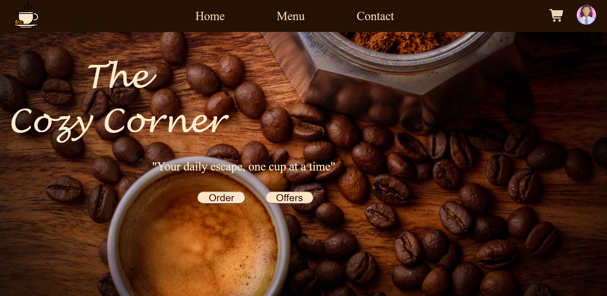
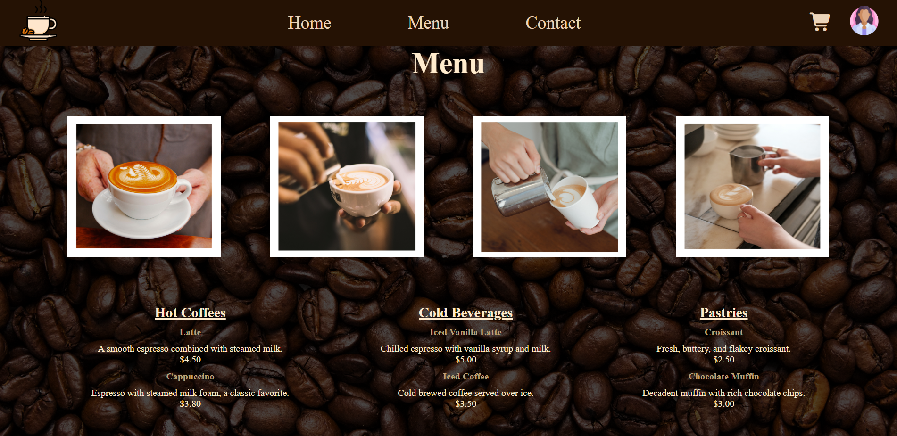
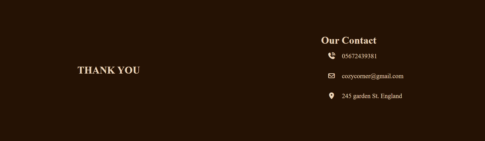

# ☕ The Cozy Corner

A responsive coffee shop website built with **HTML and CSS**, designed to present a warm and modern online presence for a fictional coffee shop.

The website includes a landing page, coffee menu, brand story, contact information, and responsive styling for different screen sizes.

## ✨ Features

- Responsive coffee shop landing page
- Fixed navigation bar
- Hero section with call-to-action
- Coffee menu and product presentation
- "Essence of Coffee" section
- About Us section
- Contact information and footer
- Custom images and visual assets
- Responsive layout using CSS media queries


## 📸 Application Screenshots

### Homepage


### Coffee Menu


### Contact



## 🛠️ Technologies

- HTML5
- CSS3
- Responsive Web Design
- CSS Media Queries
- Git & GitHub
- Vercel

## 📁 Project Structure

```text
the-cozy-corner/
│
├── img/
│   └── website assets
│
├── index.html
├── styles.css
├── .gitignore
└── README.md
```

## 🚀 Running Locally

Clone the repository:

```bash
git clone https://github.com/azzaalmousli/the-cozy-corner.git
```

Open the project folder and launch `index.html` in your browser.

No additional dependencies or installation are required.

## 💡 What This Project Demonstrates

- Semantic HTML structure
- CSS styling and layouts
- Responsive web design
- Navigation and section-based page structure
- Visual asset integration
- Front-end website deployment